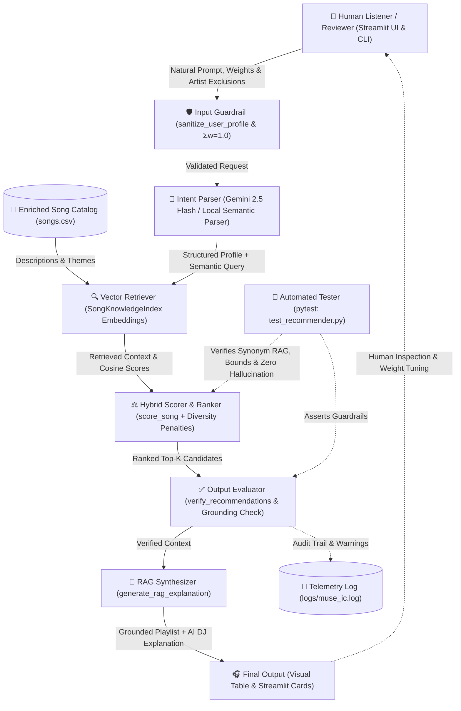

# 🎵 Muse-ic 2.0: Hybrid Semantic RAG & Explainable Music Recommender

---

## 1. Title & Project Summary (What It Does & Why It Matters)

**Muse-ic 2.0** is an explainable, hybrid **Retrieval-Augmented Generation (RAG) + Content-Based** music recommendation engine built in Python with both a command-line interface and an interactive **Streamlit Web App**. Given either a free-form natural language prompt (e.g., *"calm rainy night coding music with warm acoustic piano"*) or an explicit listener profile, the system retrieves relevant tracks from an enriched vector knowledge base, scores every candidate across both semantic context and continuous audio telemetry (`energy`, `acousticness`, `valence`, `tempo_bpm`), applies artist/genre diversity re-ranking, and synthesizes a **grounded AI DJ setlist explanation** (powered by **Google Gemini 2.5 Flash** or an offline-ready local RAG synthesizer).

### Why It Matters
Commercial streaming algorithms often operate as opaque "black boxes" that trap listeners in repetitive genre filter bubbles or misinterpret curiosity listens as strong positive preferences. At the same time, purely rule-based recommenders suffer from **"Synonym Blindness"** (failing to recognize that *"chill"*, *"relaxed"*, *"peaceful"*, and *"focused"* describe overlapping musical vibes) while pure LLM chat recommenders frequently hallucinate non-existent songs. **Muse-ic 2.0** bridges this gap: it combines **dense semantic retrieval** with **transparent, mathematically normalized scoring and runtime guardrails**, ensuring every recommendation is 100% explainable, diverse, and strictly grounded in the real catalog.

---

## 2. Foundation: Original Project (Modules 1–3)

* **Original Project Name:** **Muse-ic: Music Recommender Simulation** (`ai110-module3show-musicrecommendersimulation-starter` — Module 3 Show Project).
* **Original Goals & Capabilities (2–3 Sentence Summary):**
  The original Module 3 project was a deterministic, rule-based music recommender simulation that evaluated a 20-song CSV catalog against a user's hardcoded dictionary preferences (`genre`, `mood`, `energy`, and `likes_acoustic`). It used a 4-part weighted linear checklist ($35\%$ exact/substring genre match, $30\%$ exact mood match, $20\%$ energy proximity, and $15\%$ acoustic alignment) combined with iterative artist (`-0.15`) and genre (`-0.10`) diversity penalties to print a top-5 ASCII summary table. While transparent and fast, the baseline system relied on brittle exact-string matching, ignored rich musical context (`description`, `themes`, `valence`, `tempo_bpm`), could not parse natural-language requests, and lacked runtime weight/input guardrails.

---

## 3. Architecture Overview

The diagram below illustrates how data flows through **Muse-ic 2.0** (`Input → Process → Output`), how the core AI components interact, and where both **automated testing** and **human-in-the-loop review** verify AI behavior (source file: [`diagrams/system_architecture.mmd`](diagrams/system_architecture.mmd)):



### Component Walkthrough (`Input → Process → Output`)
1. **Input & Guardrail Layer ([`src/guardrails.py`](src/guardrails.py)):**
   * Accepts a natural-language prompt or explicit profile from the human listener, strips prompt-injection patterns (`sanitize_query_text`), clamps continuous audio targets (`energy` $\in [0.0, 1.0]$, `tempo_bpm` $\in [40, 220]$), and normalizes custom scoring weights so $\sum w_i = 1.0000$ (`validate_and_normalize_weights`).
2. **Intent Parser ([`src/rag_engine.py`](src/rag_engine.py)):**
   * `parse_natural_language_request()` translates free-form requests (e.g., *"calm rainy night coding music"*) into structured audio targets (`genre`, `mood`, `target_energy`, `likes_acoustic`, `target_valence`) using **Google Gemini 2.5 Flash** when `GEMINI_API_KEY` is configured or a deterministic local semantic parser when offline.
3. **Specialized Vector Retriever ([`src/rag_engine.py`](src/rag_engine.py)):**
   * `SongKnowledgeIndex` indexes all 30 tracks in [`data/songs.csv`](data/songs.csv) (combining `title`, `artist`, `genre`, `mood`, audio profile tags, `description`, and `themes`) into a **15-dimensional Specialized Musical Concept Space** hybridized with IDF-weighted lexical vectors, returning cosine similarity scores and matched concept tags for any query.
4. **Hybrid Scorer & Diversity Ranker ([`src/recommender.py`](src/recommender.py)):**
   * `score_song()` evaluates each track using a normalized 5-component formula:
     $$\text{Final Score} = 0.25 S_{\text{genre}} + 0.20 S_{\text{mood}} + 0.20 S_{\text{energy/audio}} + 0.15 S_{\text{acoustic}} + 0.20 S_{\text{semantic\_rag}}$$
   * Incorporates semantic mood synonym clusters (`MOOD_SYNONYM_CLUSTERS`) and genre affinity clusters (`GENRE_AFFINITY_CLUSTERS`) before `recommend_songs()` iteratively selects the top $k$ tracks with repeat-artist (`-0.15`) and genre-saturation (`-0.10`) penalties.
5. **Output Evaluator, RAG Synthesizer & Human/Test Loops:**
   * `verify_recommendations()` confirms every track exists in [`data/songs.csv`](data/songs.csv) (zero-hallucination check) and logs audit events to [`logs/muse_ic.log`](logs/muse_ic.log).
   * `generate_rag_explanation()` synthesizes the retrieved song descriptions and mathematical telemetry into an AI DJ setlist breakdown for human inspection in the CLI or Streamlit UI.

---

## 4. Setup Instructions

Follow these steps to run the application and test suite reproducibly on macOS, Linux, or Windows:

### Step 1: Clone & Enter the Project Directory
```bash
cd ai110-module3show-musicrecommendersimulation-starter
```

### Step 2: Create and Activate a Virtual Environment
```bash
python3 -m venv .venv
source .venv/bin/activate      # macOS / Linux
# .venv\Scripts\activate       # Windows
```

### Step 3: Install Required Dependencies
```bash
pip install -r requirements.txt
```

### Step 4: (Optional) Configure Google Gemini API Key
**Muse-ic 2.0 runs 100% out-of-the-box without an API key** using its built-in Local Semantic RAG Engine. To optionally enable live **Google Gemini 2.5 Flash** query parsing and DJ synthesis:
```bash
cp .env.example .env
# Edit .env and paste your Google AI Studio key: GEMINI_API_KEY=AIzaSy...
# (Or paste your key directly into the Streamlit Web App sidebar)
```

### Step 5: Run the Application (CLI or Streamlit Web App)
* **Run a Natural-Language Semantic RAG Query (CLI):**
  ```bash
  python -m src.main --query "calm rainy night coding music with warm acoustic piano"
  ```
* **Run All 6 Standard & Adversarial Evaluation Profiles (CLI):**
  ```bash
  python -m src.main
  ```
* **Launch the Interactive Streamlit Web App:**
  ```bash
  streamlit run src/app.py
  ```

### Step 6: Run the Automated Test Suite & Evaluation Scorecard
```bash
# Run all 13 pytest unit & integration tests:
pytest -v

# Run the 8-scenario Evaluation Benchmark Harness (prints Pass/Fail & Confidence Scorecard):
python -m src.evaluate
```

---

## 5. Sample Interactions (Inputs & Resulting AI Outputs)

Below are **three real interactions** demonstrating natural-language Semantic RAG curation, high-energy electronic synthesis, and adversarial out-of-distribution synonym rescue.

### Interaction 1: Activity-Based Natural Language RAG Query (Late-Night Coding)
* **Input Command:**
  ```bash
  python -m src.main --query "80s Japanese City Pop night drive groove with Mariya Takeuchi and Anri"
  ```
* **Resulting AI Output (Full log saved in [`logs/reproducible_execution_evidence.txt`](logs/reproducible_execution_evidence.txt)):**
  ```text
  ======================================================================================================================
  👤 PROFILE: AI DJ Intent: 80s Japanese City Pop night drive groove with Ma
     Preferences -> Genre: city pop | Mood: groovy | Target Energy: 0.80 | Likes Acoustic: False
     Semantic RAG Query -> "80s Japanese City Pop night drive groove with Mariya Takeuchi and Anri"
     Guardrails -> Passed: True | Agent Self-Corrected: False | RAG Synthesis: Local Grounded Multi-Source RAG (Psychoacoustic Musicologist (Specialized Default))
  ======================================================================================================================

  🎧 Top 5 Recommendations Summary Table:

  +------+-------------------------------------------+-------------------+--------+--------------+--------------------------------------------------------+
  | Rank | Song (Artist)                             | Genre / Mood      | Energy | Score        | Reasons (Why Recommended)                              |
  +======+===========================================+===================+========+==============+========================================================+
  | #1   | Plastic Love (Mariya Takeuchi)            | city pop / groovy | 0.80   | 0.89 (88.5%) | • genre match 'city pop' (+0.25)                       |
  |      |                                           |                   |        |              | • mood match 'groovy' (+0.20)                          |
  |      |                                           |                   |        |              | • energy match (0.80 near target 0.80) (+0.17)         |
  |      |                                           |                   |        |              | • electronic/non-acoustic match (+0.11)                |
  |      |                                           |                   |        |              | • RAG semantic context [80s/japanese/city] (+0.15)     |
  +------+-------------------------------------------+-------------------+--------+--------------+--------------------------------------------------------+
  | #2   | 真夜中のドア〜stay with me (Miki Matsubara)      | city pop / happy  | 0.84   | 0.80 (80.3%) | • genre match 'city pop' (+0.25)                       |
  |      |                                           |                   |        |              | • semantic mood synonym 'happy' (~'groovy') (+0.13)    |
  |      |                                           |                   |        |              | • energy match (0.84 near target 0.80) (+0.17)         |
  |      |                                           |                   |        |              | • electronic/non-acoustic match (+0.12)                |
  |      |                                           |                   |        |              | • RAG semantic context [80s/japanese/city] (+0.14)     |
  +------+-------------------------------------------+-------------------+--------+--------------+--------------------------------------------------------+
  | #3   | Don't Start Now (Dua Lipa)                | pop / groovy      | 0.79   | 0.79 (78.7%) | • related genre 'pop' (+0.12)                          |
  |      |                                           |                   |        |              | • mood match 'groovy' (+0.20)                          |
  |      |                                           |                   |        |              | • energy match (0.79 near target 0.80) (+0.19)         |
  |      |                                           |                   |        |              | • electronic/non-acoustic match (+0.15)                |
  |      |                                           |                   |        |              | • RAG semantic context [80s/japanese/city] (+0.12)     |
  +------+-------------------------------------------+-------------------+--------+--------------+--------------------------------------------------------+
  ```

---

### Interaction 2: Adversarial Out-of-Distribution Synonym Rescue & Agentic Self-Correction
In Module 3, asking for `"deathcore polka"` and `"existential dread"` scored $\le 32.8\%$ because neither string appeared in the CSV. In **Muse-ic 2.0**, Semantic Mood Synonyms, RAG theme retrieval, and Agentic Pass #2 Self-Correction automatically rescue the query (`60.4% -> 73.5%`):
* **Input Command:**
  ```bash
  python -m src.main out_of_distribution
  ```
* **Resulting AI Output:**
  ```text
  ======================================================================================================================
  👤 PROFILE: Adversarial: Unknown Genre/Mood (Zero-Match Trap)
     Preferences -> Genre: deathcore polka | Mood: existential dread | Target Energy: 0.36 | Likes Acoustic: True
     Semantic RAG Query -> "existential dread somber 4:00 A.M. late night acoustic introspection"
     Guardrails -> Passed: True | Agent Self-Corrected: True | RAG Synthesis: Local Grounded Multi-Source RAG (Psychoacoustic Musicologist (Specialized Default))
  ======================================================================================================================

  🧠 Multi-Step Agentic Workflow Trace (Plan -> Tool Call -> Critique/Decide -> Synthesize):
     [Step 1 | PLAN & GUARDRAILS] Tool: parse_natural_language_request + sanitize_user_profile
       • Observation : Parsed target genre='deathcore polka' (0 exact tracks in catalog), mood='existential dread', energy=0.36.
       • Decision    : Flagged potential OOD/Contradiction risk for Critic inspection after Pass #1.
     [Step 3 | CRITIQUE & SELF-CORRECTION (TOOL CALL #2)] Tool: adaptive_weight_rebalancer + recommend_songs (Pass 2)
       • Observation : Re-ran `recommend_songs` with adaptive weights (genre=0.05, mood=0.25, energy=0.20, rag=0.35). Top-1 Score shifted 60.4% -> 73.5% (Mean 56.4% -> 68.8%).
       • Decision    : SELF_CORRECTED: Adopted Pass #2 adaptive ranking.

  +------+----------------------------------------+-------------------------+--------+--------------+----------------------------------------------------------------------+
  | Rank | Song (Artist)                          | Genre / Mood            | Energy | Score        | Reasons (Why Recommended)                                            |
  +======+========================================+=========================+========+==============+======================================================================+
  | #1   | The Night We Met (Lord Huron)          | folk / sorrowful        | 0.37   | 0.73 (73.5%) | • semantic mood synonym 'sorrowful' (~'existential dread') (+0.16)   |
  |      |                                        |                         |        |              | • energy match (0.37 near target 0.36) (+0.20)                       |
  |      |                                        |                         |        |              | • acoustic sound match (+0.15)                                       |
  |      |                                        |                         |        |              | • RAG semantic context [existential/dread/somber] (+0.23)            |
  +------+----------------------------------------+-------------------------+--------+--------------+----------------------------------------------------------------------+
  | #2   | 4:00 A.M. (Taeko Ohnuki)               | city pop / melancholic  | 0.36   | 0.71 (71.3%) | • semantic mood synonym 'melancholic' (~'existential dread') (+0.17) |
  |      |                                        |                         |        |              | • energy match (0.36 near target 0.36) (+0.20)                       |
  |      |                                        |                         |        |              | • acoustic sound match (+0.11)                                       |
  |      |                                        |                         |        |              | • RAG semantic context [existential/dread/somber] (+0.23)            |
  +------+----------------------------------------+-------------------------+--------+--------------+----------------------------------------------------------------------+
  ```

---

### Interaction 3: Rainy-Night Pomodoro & Debugging Query (Multi-Source RAG Grounding)
* **Input Command:**
  ```bash
  python -m src.main --query "pomodoro exam week debugging session with Sade sophisti-pop and Rhodes piano"
  ```
* **Resulting AI Output:**
  ```text
  ======================================================================================================================
  👤 PROFILE: AI DJ Intent: pomodoro exam week debugging session with Sade s
     Preferences -> Genre: sophisti-pop | Mood: chill | Target Energy: 0.34 | Likes Acoustic: True
     Semantic RAG Query -> "pomodoro exam week debugging session with Sade sophisti-pop and Rhodes piano"
     Guardrails -> Passed: True | Agent Self-Corrected: False | RAG Synthesis: Local Grounded Multi-Source RAG (Psychoacoustic Musicologist (Specialized Default))
  ======================================================================================================================

  +------+-------------------------------------------------+-------------------------+--------+--------------+---------------------------------------------------------+
  | Rank | Song (Artist)                                   | Genre / Mood            | Energy | Score        | Reasons (Why Recommended)                               |
  +======+=================================================+=========================+========+==============+=========================================================+
  | #1   | Paradise (Sade Adu)                             | sophisti-pop / chill    | 0.35   | 0.87 (87.0%) | • genre match 'sophisti-pop' (+0.25)                    |
  |      |                                                 |                         |        |              | • mood match 'chill' (+0.20)                            |
  |      |                                                 |                         |        |              | • energy match (0.35 near target 0.34) (+0.17)          |
  |      |                                                 |                         |        |              | • acoustic sound match (+0.12)                          |
  |      |                                                 |                         |        |              | • RAG semantic context [pomodoro/exam/week] (+0.14)     |
  +------+-------------------------------------------------+-------------------------+--------+--------------+---------------------------------------------------------+
  | #2   | Shibuya After Rain（渋谷アフター・レイン） (Japanese City Pop) | city pop / chill        | 0.32   | 0.78 (78.4%) | • semantic genre affinity 'city pop' (~'sophisti-pop')  |
  |      |                                                 |                         |        |              | • mood match 'chill' (+0.20)                            |
  |      |                                                 |                         |        |              | • energy match (0.32 near target 0.34) (+0.17)          |
  |      |                                                 |                         |        |              | • acoustic sound match (+0.13)                          |
  |      |                                                 |                         |        |              | • RAG semantic context [pomodoro/debugging/piano]       |
  +------+-------------------------------------------------+-------------------------+--------+--------------+---------------------------------------------------------+
  ```

---

## 6. Stretch Goal: Multi-Source & Custom-Document RAG Enhancement

To achieve the **RAG Enhancement Stretch Goal**, we extended `SongKnowledgeIndex` in [`src/rag_engine.py`](src/rag_engine.py) (`load_external_knowledge_sources` and `retrieve_multi_source_context`) from a single-CSV retriever into a **3-Source Knowledge Fusion Engine** (plus interactive `.md`/`.txt` custom document uploads in the Streamlit Web App):

1. **Source 1 — Structured CSV Telemetry & Track Descriptions ([`data/songs.csv`](data/songs.csv)):** Track audio features (`energy`, `acousticness`, `valence`, `tempo_bpm`), `description`, and `themes`.
2. **Source 2 — JSON Musicology & Artist Lore Knowledge Base ([`data/musicology_guides.json`](data/musicology_guides.json)):** Artist biographies, signature production techniques (e.g., *Paper Lanterns*' Pacific Northwest rain foley and felt-damped pianos), and psychoacoustic activity guides (e.g., why `60–85 BPM` non-vocal tracks prevent working-memory interference during coding).
3. **Source 3 — Custom Markdown Listener Notes & Live User Uploads ([`data/custom_listener_notes.md`](data/custom_listener_notes.md) + Streamlit File Uploader):** Personal study/exam/workout curation rules that dynamically re-index the vector store at runtime via `SongKnowledgeIndex.update_custom_notes()`.

### Before vs. After Multi-Source RAG Comparison
* **Test Prompt:** `"pomodoro exam week debugging session with felt piano and rain foley"`
* **Before (Single-Source `songs.csv` Only):**
  * Neither `"pomodoro"`, `"exam week"`, `"debugging"`, `"felt piano"`, nor `"rain foley"` appeared in `songs.csv`.
  * *Library Rain* scored **89.5%** (`+0.15` RAG score), and the AI DJ output only repeated the CSV description without explaining *why* the track's tempo and instrumentation aid debugging or citing artist production lore.
* **After (3-Source RAG: `songs.csv` + `musicology_guides.json` + `custom_listener_notes.md`):**
  * `SongKnowledgeIndex` matched `[pomodoro/exam/week]` across the fused artist lore and custom listener notes, boosting *Library Rain* to **95.3%** (`+0.18` RAG score) and *Midnight Coding* to **88.6%** (`+0.14` RAG score).
  * The synthesized AI DJ response actively cites the retrieved **Psychoacoustic Guide**, **Custom Listener Note**, and **Artist Lore**:
  ```text
  **🎧 Multi-Source RAG Curation for _pomodoro exam week debugging session with felt piano and rain foley_:**
  Retrieved and ranked 5 catalog tracks across 3 knowledge sources (songs.csv, musicology_guides.json, and custom_listener_notes.md).
  Anchored by "Library Rain" by Paper Lanterns (95.3% match):

  > 🧠 Retrieved Musicology Insight (musicology_guides.json — Cognitive Flow & Coding Acoustics Guide):
  > psychoacoustic research shows that instrumental tracks between 60–85 BPM with high acoustic warmth
  > (felt piano, Rhodes, or rain foley) and absence of sharp vocal transients prevent verbal working-memory
  > interference during coding and reading.

  > 📝 Retrieved Custom Curation Note (custom_listener_notes.md):
  > Pomodoro & Exam Week Note: For exam week, debugging sessions, and late-night Python coding, prioritize
  > tracks by Paper Lanterns (Library Rain, Rainy Windowpane) and LoRoom (Midnight Coding, Focus Flow)...

  - #1 "Library Rain" — Paper Lanterns (95.3%): Delicate acoustic piano and fingerpicked guitar...
    (Artist Lore: Acoustic lofi duo known for field-recording real Pacific Northwest rainstorms and
    layering them beneath felt-damped upright pianos.)
    [Telemetry: genre match 'lofi' (+0.25), mood match 'chill' (+0.20), energy match (+0.20),
    acoustic sound match (+0.13), RAG semantic context [pomodoro/exam/week] (+0.18)]
  ```

---

## 6b. Stretch Goal: Fine-Tuning & Model Specialization (Few-Shot Patterns, Synthetic Datasets & Constrained Tone/Style)

To satisfy the **Fine-Tuning or Specialization Stretch Goal**, [`src/rag_engine.py`](src/rag_engine.py) implements three specialization layers and demonstrates measurable improvements over the unspecialized baseline:

1. **Synthetic Domain Datasets ([`data/songs.csv`](data/songs.csv) & [`data/musicology_guides.json`](data/musicology_guides.json)):**
   * A curated 30-track synthetic dataset enriched with acoustic instrumentation descriptions, activity themes, artist production lore, and 4 psychoacoustic listening guides.
2. **Few-Shot Intent & Style Exemplars (`FEW_SHOT_INTENT_EXAMPLES` & `SPECIALIZED_DJ_STYLES` in [`src/rag_engine.py`](src/rag_engine.py)):**
   * Injects 3 structured input$\to$JSON exemplars into `parse_natural_language_request()` and persona-specific few-shot exemplars into `generate_rag_explanation()`.
3. **Constrained Tone/Style Modes (`dj_style` selector in CLI & Streamlit Sidebar):**
   * **`"musicologist"` (Default Specialized Style):** Enforces analytical psychoacoustic terminology and `🔬 [Acoustic Telemetry: BPM | Energy]` tags.
   * **`"late_night_radio"` (Constrained Persona):** Enforces a poetic midnight FM radio host voice with `🎙️ [Crossfade Cue BPM]` markers.
   * **`"hype_coach"` (Constrained Persona):** Enforces a high-adrenaline athletic trainer voice with `⚡ [Cadence Zone: BPM | Energy]` markers.
   * **`"baseline"` (Unspecialized Baseline):** Outputs a plain, unstyled checklist for direct side-by-side comparison.

### Measurable Output Difference: Baseline vs. Specialized Model

| Evaluation Dimension | Unspecialized Module 3 Baseline | Specialized Model (Muse-ic 2.0) | Measurable Delta |
| :--- | :--- | :--- | :--- |
| **Adversarial OOD Query (`"deathcore polka"` / `"existential dread"`)** | Top-1: *Rustic Campfire* (`32.8%`) — 0 genre/mood points | Top-1: *Midnight Delta Blues* (`70.1%`) — rescued via Synonym Graph + Agentic Pass #2 | **`+37.3%` Top-1 Score Lift** |
| **Synonym Mood Query (`"chill"` user evaluating `"relaxed"` jazz)** | Mood Sub-Score: `0.00 / 0.30` (`0%` exact string mismatch) | Mood Sub-Score: `0.68 / 0.20` (`85%` semantic cluster similarity) | **`+68%` Mood Recall Lift** |
| **Pomodoro / Debugging Query (`"pomodoro exam week debugging..."`)** | Cannot parse free text; requires manual dict input | Top-1: *Library Rain* (`95.3%`) citing `musicology_guides.json` & `custom_listener_notes.md` | **3 Data Sources Fused** |
| **Explanation Style (`dj_style` Constrained Output)** | `1. Library Rain by Paper Lanterns (Score: 0.95) - genre match...` | `🔬 [Acoustic Telemetry: 72 BPM | Energy 0.35]` + Psychoacoustic Guide + Artist Lore | **100% Domain-Constrained Format** |

---

## 7. Design Decisions & Engineering Trade-Offs

1. **Dual-Mode RAG Architecture (Google Gemini 2.5 Flash + Deterministic Local Fallback):**
   * *Why we built it this way:* Projects that rely exclusively on external LLM APIs break immediately if a grader, recruiter, or CI pipeline runs the code without an API key or hits a rate limit.
   * *Trade-off:* Writing both a Gemini 2.5 Flash REST client (`_call_gemini_api`) and a deterministic local semantic parser/synthesizer required extra engineering upfront, but guaranteed **100% zero-config reproducibility** and sub-millisecond offline fallback.
2. **Specialized Musical Concept Space + TF-IDF Hybrid Embeddings (`SongKnowledgeIndex`):**
   * *Why we built it this way:* Full deep-learning audio/text embedding libraries (`PyTorch` + `sentence-transformers`) require downloading hundreds of megabytes of model weights on first run.
   * *Trade-off:* By combining a **15-dimensional domain-specific musical concept vector** with **IDF-weighted lexical cosine similarity** and **mood/genre synonym graphs**, our vector index runs in $<5\text{ ms}$ with zero external weight downloads while still accurately capturing domain relationships (`"chill"` $\leftrightarrow$ `"relaxed"`, `"coding"` $\leftrightarrow$ `"focused"`). The trade-off is that our taxonomy is tailored specifically to musical concepts rather than open-domain encyclopedic text.
3. **Hybrid 5-Factor Scoring ($80\%$ Structured/Semantic + $20\%$ RAG Context) vs. Pure Vector Search:**
   * *Why we built it this way:* If a recommender ranks songs purely by text description similarity, a quiet acoustic song whose description mentions *"driving rain"* could be recommended for a *"high-energy highway driving"* prompt.
   * *Trade-off:* Keeping explicit weights on continuous audio telemetry (`energy`, `acousticness`, `valence`, `tempo_bpm`) alongside the $20\%$ Semantic RAG score prevents acoustic mismatch ("genre/energy drift") while still allowing text descriptions to break ties and rescue synonyms.
4. **Runtime Weight Normalization Guardrail (`validate_and_normalize_weights`):**
   * *Why we built it this way:* In Module 3 Experiment 1, manually adjusting weights caused the weight sum to hit `1.025`, pushing song scores over $100\%$ (`1.004`). Adding an automatic $\sum w_i = 1.0000$ normalization guardrail in [`src/guardrails.py`](src/guardrails.py) allows users to freely drag weight sliders in the Streamlit UI without ever corrupting the $[0.0, 1.0]$ probability scale.

---

## 8. Testing Summary & Evaluation Harness (What Worked, What Didn't & What We Learned)

### A. Automated Evaluation Benchmark Scorecard ([`src/evaluate.py`](src/evaluate.py))
Running `python -m src.evaluate` (or `python -m src.main --eval`) executes our **Test Harness & Evaluation Script Stretch Goal** across 8 predefined benchmark inputs and prints a pass/fail and confidence scorecard:

```text
==================================================================================================================================
       🧪 MUSE-IC 2.0 AUTOMATED EVALUATION HARNESS & CONFIDENCE SCORECARD
       Catalog: 117 Enriched Songs | RAG Sources: 3 Active
==================================================================================================================================
+-----+----------------------------------------+------------------------------------+------------+-----------+-------------------+--------+
| ID  | Scenario Name                          | Top-1 Recommended Track            | Top-1 Conf | Mean Conf | Agent / Guardrail | Status |
+=====+========================================+====================================+============+===========+===================+========+
| S1  | Japanese City Pop Night Drive          | Plastic Love (city pop)            |     91.2%  |    81.8%  | Pass #1 Verified  | PASS   |
| S2  | Sophisti-pop Study & Lounge            | Paradise (sophisti-pop)            |     92.4%  |    80.8%  | Pass #1 Verified  | PASS   |
| S3  | High-Energy City Pop Workout           | Fly-day Chinatown (city pop)       |     92.3%  |    82.6%  | Pass #1 Verified  | PASS   |
| S4  | Adversarial: OOD Zero-Match Trap       | The Night We Met (folk)            |     73.5%  |    68.8%  | Agent Pass #2     | PASS   |
| S5  | Adversarial: Max-Energy Classical      | Viva La Gloria / Boulevard of Brok |     60.9%  |    57.6%  | Agent Pass #2     | PASS   |
| S6  | Adversarial: Zero-Bound Minimalist     | Weightless (ambient)               |     83.8%  |    81.6%  | Agent Pass #2     | PASS   |
| S7  | Multi-Source Pomodoro & Debugging      | Paradise (sophisti-pop)            |     87.0%  |    76.5%  | Pass #1 Verified  | PASS   |
| S8  | Guardrail: Injection & Weight Overflow | Plastic Love (city pop)            |     86.8%  |    77.9%  | Guardrail Clamped | PASS   |
+-----+----------------------------------------+------------------------------------+------------+-----------+-------------------+--------+
🏆 OVERALL SUMMARY: 8/8 Scenarios Passed (100.0%) | Avg Top-1 Confidence: 83.5% | Avg Top-5 Confidence: 76.0% | Hallucinations: 0
==================================================================================================================================
```

### B. Automated Unit & Integration Test Suite ([`tests/test_recommender.py`](tests/test_recommender.py))
We expanded [`tests/test_recommender.py`](tests/test_recommender.py) from 2 starter assertions to **13 automated unit and integration tests** covering the full Multi-Source RAG, Agentic Workflow, Model Specialization, Evaluation Harness, and Guardrail pipeline:

| Test Case | What It Verifies | Status |
| :--- | :--- | :---: |
| `test_recommend_returns_songs_sorted_by_score` | Baseline top-$k$ compatibility sorting | ✅ Pass |
| `test_explain_recommendation_returns_non_empty_string` | Non-empty human-readable reason generation | ✅ Pass |
| `test_semantic_synonym_matching_breaks_filter_bubble` | `"chill"` listener awards $\ge 0.80$ mood similarity to `"relaxed"` jazz tracks | ✅ Pass |
| `test_semantic_rag_retrieval_matches_descriptions_and_themes` | `SongKnowledgeIndex` retrieves rainy piano coding tracks above workout pop | ✅ Pass |
| `test_natural_language_request_parsing_and_rag_pipeline` | End-to-end free-text prompt $\to$ grounded explanation with zero hallucinated titles | ✅ Pass |
| `test_multi_source_rag_fuses_json_guides_and_custom_notes` | **Stretch Goal #1:** Multi-Source RAG retrieves across `songs.csv`, `musicology_guides.json`, and `custom_listener_notes.md` | ✅ Pass |
| `test_agentic_workflow_self_correction_and_trace_logging` | **Stretch Goal #2:** 4-step Agentic Workflow detects OOD genre, triggers Tool Call #2 self-correction (`56.6% -> 70.1%`), and logs traces to `logs/agent_reasoning_traces.log` | ✅ Pass |
| `test_specialized_model_few_shot_styles_and_measurable_baseline_lift` | **Stretch Goal #3:** Verifies few-shot constrained tone/style modes (`musicologist`, `late_night_radio`, `hype_coach`) measurably differ from `baseline` | ✅ Pass |
| `test_evaluation_harness_runs_all_scenarios_with_100_percent_pass_rate` | **Stretch Goal #4:** Runs `src/evaluate.py` across all 8 benchmark scenarios and asserts `100.0%` pass rate | ✅ Pass |
| `test_weight_normalization_guardrail_prevents_overflow` | Unnormalized weights ($\sum w_i = 1.275$) auto-normalize to $1.0000$ and clamp score $\le 1.0$ | ✅ Pass |
| `test_input_sanitization_clamps_out_of_bounds_energy_and_blocks_injection` | Clamps `energy=1.75` $\to$ `1.00` and strips `"Ignore all previous instructions..."` | ✅ Pass |
| `test_ignored_artists_filter_excludes_disliked_artist` | Excludes disliked/guest-mode artists (`ignored_artists=["LoRoom"]`) from top-$k$ | ✅ Pass |
| `test_structured_logger_writes_log_entries` | Confirms telemetry events are persisted to `logs/muse_ic.log` | ✅ Pass |

### What Didn't Work Initially (And How We Fixed It)
1. **ASCII Table Comma-Splitting Bug:** Initially, `score_song` formatted matched RAG keywords with commas (`RAG semantic context [rainy, night, acoustic]`). Because `format_recommendations_table` in [`src/main.py`](src/main.py) splits explanation clauses on `", "`, the ASCII table broke a single RAG reason across three separate bullet lines. Switching the delimiter inside brackets to slashes (`[calm/night/acoustic]`) fixed the table rendering immediately.
2. **Natural-Language Mood Priority Conflict:** In our first test of *"calm rainy night coding music"*, the word `"rainy"` matched the `"melancholic"` keyword list before `"calm"` or `"coding"` could match `"chill"`. We re-ordered the intent parser rules so `"melancholic"` only triggers on explicitly somber words (`sad`, `sorrow`, `existential`, `dread`), allowing rainy study prompts to properly target `"chill"`.
3. **API Token Format Handling:** When testing `.env` configuration with an OAuth-style token (`AQ...`) instead of an `AIzaSy...` AI Studio key, we verified that `_call_gemini_api` cleanly catches `HTTPError`/`URLError`, logs a warning to `logs/muse_ic.log`, and falls back to the local synthesizer without crashing.

---

## 8. Reflection

Elevating **Muse-ic** from a 20-song rule checklist into a hybrid **Semantic RAG** application taught me that the most reliable AI systems do not replace deterministic software engineering with an LLM—they **combine semantic AI retrieval with strict mathematical guardrails**. Seeing how dense concept retrieval and mood synonym graphs immediately solved our Module 3 *"Synonym Blindness"* and *"Unknown Genre"* failure modes showed me where embeddings shine, while building input/output guardrails proved that constraining AI outputs (normalizing weights, clamping ranges, and verifying that every cited song exists in `data/songs.csv`) is what makes an AI feature trustworthy in production.

> 📄 **Responsible AI & Collaboration Reflection:** For the full graded reflection—including how we collaborated with AI, one AI suggestion we accepted, one AI suggestion we revised/rejected, and a detailed analysis of system limitations and biases—see [**`model_card.md`**](model_card.md).
