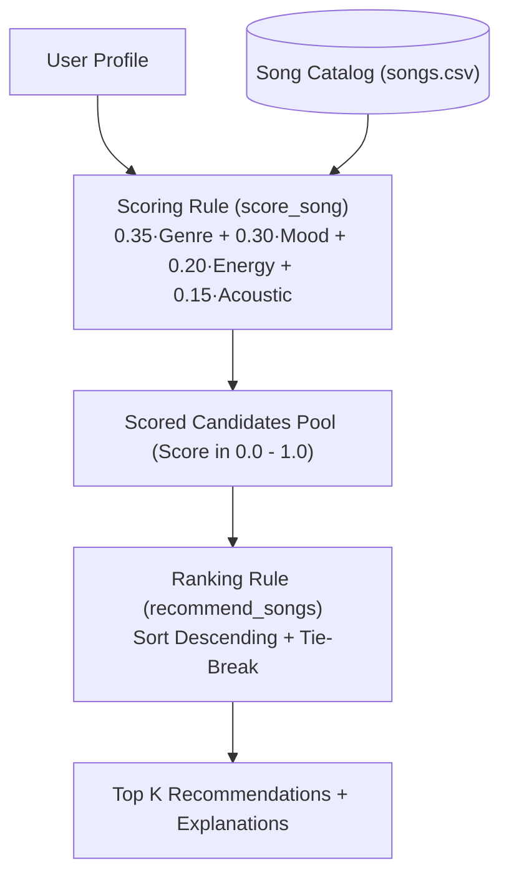

# 🎵 Music Recommender Simulation

## Project Summary

In this project you will build and explain a small music recommender system.

Your goal is to:

- Represent songs and a user "taste profile" as data
- Design a scoring rule that turns that data into recommendations
- Evaluate what your system gets right and wrong
- Reflect on how this mirrors real world AI recommenders

Replace this paragraph with your own summary of what your version does.

---

## How The System Works

### Real-World Systems vs. Our Simulation
Real-world streaming platforms like Spotify and YouTube Music rely on complex hybrid engines combining collaborative filtering (mining listening habits and co-occurrences across millions of user playlists), deep neural networks analyzing raw audio spectrograms, and natural language processing of music reviews. In contrast, our simulation prioritizes a lightweight, transparent **content-based filtering** approach. Rather than relying on crowd listening histories or black-box embeddings, our version directly compares a song's musical attributes against an individual user's explicit taste preferences. This keeps the recommendation pipeline deterministic, fast, and completely explainable (providing a clear "because" reason for every recommended track).

### Simulation Features

Our simulation models the recommendation environment through two core objects:

#### 1. `Song` Features
Each song in our catalog tracks the following metadata and acoustic attributes:
* **`id`** (`int`): Unique identifier for the track.
* **`title`** (`str`): Title of the song.
* **`artist`** (`str`): Name of the performing artist.
* **`genre`** (`str`): Primary musical genre (e.g., `pop`, `lofi`, `rock`, `jazz`, `ambient`).
* **`mood`** (`str`): Intended emotional state or atmosphere (e.g., `happy`, `chill`, `intense`, `relaxed`).
* **`energy`** (`float`, `0.0`–`1.0`): Perceptual intensity, loudness, and dynamic activity.
* **`acousticness`** (`float`, `0.0`–`1.0`): Confidence score of organic/acoustic vs. electronic instrumentation.
* *(Extended acoustic attributes in data)*: **`tempo_bpm`** (speed), **`valence`** (musical positivity), and **`danceability`** (rhythm stability).

#### 2. `UserProfile` Features
A user's taste profile is represented by their explicit preferences:
* **`favorite_genre`** (`str`): The primary genre the user is seeking (e.g., `"pop"`).
* **`favorite_mood`** (`str`): The target mood or vibe for their current listening session (e.g., `"happy"`).
* **`target_energy`** (`float`, `0.0`–`1.0`): The ideal energy level (e.g., `0.80` for a workout, `0.35` for studying).
* **`likes_acoustic`** (`bool`): Preference flag indicating whether the user prefers acoustic/organic instruments (`True`) or electronic/synthesized production (`False`).

---

### Finalized Algorithm Recipe

Our recommender architecture uses a two-stage pipeline: a pointwise **Scoring Rule** followed by a listwise **Ranking Rule**.



#### 1. Pointwise Scoring Rule (`score_song`)
Each song is scored on a normalized scale from `0.0` to `1.0` using a convex combination of four sub-scores:

$$\text{Final Score} = (0.35 \times S_{\text{genre}}) + (0.30 \times S_{\text{mood}}) + (0.20 \times S_{\text{energy}}) + (0.15 \times S_{\text{acoustic}})$$

* **Genre Compatibility ($S_{\text{genre}}$, Weight: $35\%$):**
  * $1.0$ if `song.genre == user.favorite_genre`.
  * $0.5$ if `user.favorite_genre` is a substring of `song.genre` (e.g., `"pop"` in `"indie pop"`).
  * $0.0$ otherwise.
* **Mood Compatibility ($S_{\text{mood}}$, Weight: $30\%$):**
  * $1.0$ if `song.mood == user.favorite_mood`, else $0.0$.
* **Energy Proximity ($S_{\text{energy}}$, Weight: $20\%$):**
  * $1.0 - |\text{song.energy} - \text{user.target\_energy}|$. Near-perfect matches ($\Delta \le 0.10$) trigger an explanation tag.
* **Acoustic Alignment ($S_{\text{acoustic}}$, Weight: $15\%$):**
  * $\text{song.acousticness}$ if `user.likes_acoustic == True`.
  * $1.0 - \text{song.acousticness}$ if `user.likes_acoustic == False`.
* **Explanation Generation:** Generates human-readable reason clauses (e.g., *"Matches favorite genre (lofi); Matches mood (chill); Energy is near target"*) appended as a `List[str]`.

#### 2. Listwise Ranking Rule (`recommend_songs`)
1. Iterates through the catalog and scores each track via `score_song`.
2. Packages candidate tuples: `(song, score, explanation)`.
3. Sorts candidates descending by `score`. Tie-breaking sorts by smallest energy difference ($|\text{song.energy} - \text{user.target\_energy}|$).
4. Slices and returns the top $k$ items (default $k=5$).

---

### Potential Biases & Limitations

1. **Filter Bubble & High-Weight Categorical Exclusion:**
   Because genre ($35\%$) and mood ($30\%$) make up $65\%$ of the total score, songs from complementary genres (e.g., ambient or jazz for a lofi study listener) are heavily penalized even when their acoustic features match the user's intent.
2. **Catalog Representation & Starvation:**
   In a small 20-song dataset, many genres (metal, blues, reggae) have only 1–2 tracks. If a user selects one of these genres and asks for $k=5$, the system suffers from catalog starvation, causing recommendations #3–#5 to have drastically lower scores and feel disjointed.
3. **Acoustic Binarization Bias:**
   Modeling acoustic preference as a boolean (`likes_acoustic`) oversimplifies modern hybrid production (e.g., lofi tracks that layer vintage acoustic piano chords over synthetic 808 drum loops).
4. **Zero Serendipity / Exploration:**
   The algorithm is purely exploitative—it only serves what matches the explicit profile. It has no mechanism to introduce fresh or unexpected musical discoveries.

---

## Getting Started

### Setup

1. Create a virtual environment (optional but recommended):

   ```bash
   python -m venv .venv
   source .venv/bin/activate      # Mac or Linux
   .venv\Scripts\activate         # Windows

2. Install dependencies

```bash
pip install -r requirements.txt
```

3. Run the app:

```bash
python -m src.main
```

### Running Tests

Run the starter tests with:

```bash
pytest
```

You can add more tests in `tests/test_recommender.py`.

---

## Sample Recommendation Output

Paste a sample of your recommender's output here as a text block so a reader can see what it produces:

```
================================================================
🎵 MUSIC RECOMMENDER SIMULATION
================================================================
Catalog: 20 songs loaded from 'data/songs.csv'
Active User Taste Profile:
  • Genre:          pop
  • Mood:           happy
  • Target Energy:  0.80
  • Likes Acoustic: False
================================================================

🎧 Top 5 Recommendations for You:

#1. Sunrise City — Neon Echo
    Match Score : 0.97 (96.9%)
    Attributes  : Genre: pop | Mood: happy | Energy: 0.82 | Acoustic: 0.18
    Why recommended:
      ✔ genre match 'pop' (+0.35)
      ✔ mood match 'happy' (+0.30)
      ✔ energy match (0.82 near target 0.80) (+0.20)
      ✔ electronic/non-acoustic match (+0.12)
----------------------------------------------------------------
#2. Rooftop Lights — Indigo Parade
    Match Score : 0.76 (76.4%)
    Attributes  : Genre: indie pop | Mood: happy | Energy: 0.76 | Acoustic: 0.35
    Why recommended:
      ✔ related genre 'indie pop' (+0.17)
      ✔ mood match 'happy' (+0.30)
      ✔ energy match (0.76 near target 0.80) (+0.19)
      ✔ electronic/non-acoustic match (+0.10)
----------------------------------------------------------------
#3. Gym Hero — Max Pulse
    Match Score : 0.67 (66.6%)
    Attributes  : Genre: pop | Mood: intense | Energy: 0.93 | Acoustic: 0.05
    Why recommended:
      ✔ genre match 'pop' (+0.35)
      ✔ energy match (0.93 near target 0.80) (+0.17)
      ✔ electronic/non-acoustic match (+0.14)
----------------------------------------------------------------
#4. Concrete Jungle Beat — K-Rhythm
    Match Score : 0.33 (32.8%)
    Attributes  : Genre: hip hop | Mood: confident | Energy: 0.78 | Acoustic: 0.12
    Why recommended:
      ✔ energy match (0.78 near target 0.80) (+0.20)
      ✔ electronic/non-acoustic match (+0.13)
----------------------------------------------------------------
#5. Supernova Disco — Funky Odyssey
    Match Score : 0.32 (31.8%)
    Attributes  : Genre: funk | Mood: groovy | Energy: 0.85 | Acoustic: 0.15
    Why recommended:
      ✔ energy match (0.85 near target 0.80) (+0.19)
      ✔ electronic/non-acoustic match (+0.13)
----------------------------------------------------------------
```

**Screenshot or video** *(optional)*: <!-- Insert a screenshot or demo video link here -->

---

## Experiments You Tried

Use this section to document the experiments you ran. For example:

- What happened when you changed the weight on genre from 2.0 to 0.5
- What happened when you added tempo or valence to the score
- How did your system behave for different types of users

---

## Limitations and Risks

Summarize some limitations of your recommender.

Examples:

- It only works on a tiny catalog
- It does not understand lyrics or language
- It might over favor one genre or mood

You will go deeper on this in your model card.

---

## Reflection

Read and complete `model_card.md`:

[**Model Card**](model_card.md)

Write 1 to 2 paragraphs here about what you learned:

- about how recommenders turn data into predictions
- about where bias or unfairness could show up in systems like this


