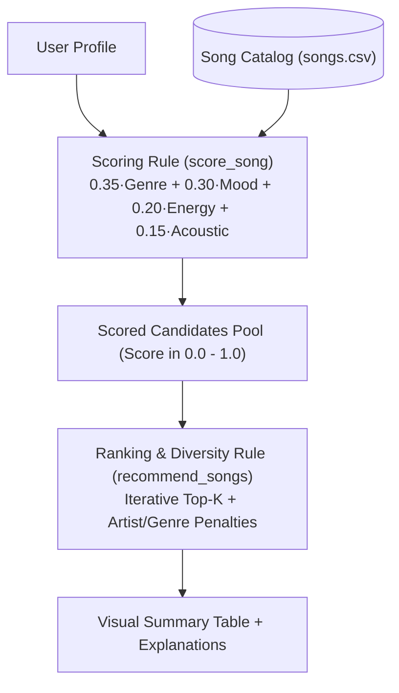

# 🎵 Muse-ic: Music Recommender Simulation

## Project Summary

**Muse-ic** is an explainable, content-based music recommender simulation built in Python. It evaluates a 20-song catalog across diverse genres and moods against a listener's explicit taste profile (`genre`, `mood`, `energy`, and `likes_acoustic`), using a weighted 100-point scoring rule to rank the top $k$ song matches and explain *why* each track was recommended in plain language.

---

## How The System Works

### Real-World Systems vs. Our Simulation
Real-world streaming platforms like Spotify and YouTube Music rely on complex hybrid engines combining collaborative filtering (mining listening habits and co-occurrences across millions of user playlists), deep neural networks analyzing raw audio spectrograms, and natural language processing of music reviews. In contrast, our simulation prioritizes a lightweight, transparent **content-based filtering** approach. Rather than relying on crowd listening histories or black-box embeddings, our version directly compares a song's musical attributes against an individual user's explicit taste preferences. This keeps the recommendation pipeline deterministic, fast, and completely explainable (providing a clear "because" reason for every recommended track).

### Simulation Features

Our simulation models the recommendation environment through two core objects:

#### 1. `Song` Features
Each song in our catalog tracks the following metadata and acoustic attributes:
* **`id`** (`int`): Unique identifier for the track.
* **`title`** (`str`): Title of the song.
* **`artist`** (`str`): Name of the performing artist.
* **`genre`** (`str`): Primary musical genre (e.g., `pop`, `lofi`, `rock`, `jazz`, `ambient`).
* **`mood`** (`str`): Intended emotional state or atmosphere (e.g., `happy`, `chill`, `intense`, `relaxed`).
* **`energy`** (`float`, `0.0`–`1.0`): Perceptual intensity, loudness, and dynamic activity.
* **`acousticness`** (`float`, `0.0`–`1.0`): Confidence score of organic/acoustic vs. electronic instrumentation.
* *(Extended acoustic attributes in data)*: **`tempo_bpm`** (speed), **`valence`** (musical positivity), and **`danceability`** (rhythm stability).

#### 2. `UserProfile` Features
A user's taste profile is represented by their explicit preferences:
* **`favorite_genre`** (`str`): The primary genre the user is seeking (e.g., `"pop"`).
* **`favorite_mood`** (`str`): The target mood or vibe for their current listening session (e.g., `"happy"`).
* **`target_energy`** (`float`, `0.0`–`1.0`): The ideal energy level (e.g., `0.80` for a workout, `0.35` for studying).
* **`likes_acoustic`** (`bool`): Preference flag indicating whether the user prefers acoustic/organic instruments (`True`) or electronic/synthesized production (`False`).

---

### Finalized Algorithm Recipe

Our recommender architecture uses a two-stage pipeline: a pointwise **Scoring Rule** followed by a listwise **Ranking Rule**.



#### 1. Pointwise Scoring Rule (`score_song`)
Each song is scored on a normalized scale from `0.0` to `1.0` using a convex combination of four sub-scores:

$$\text{Final Score} = (0.35 \times S_{\text{genre}}) + (0.30 \times S_{\text{mood}}) + (0.20 \times S_{\text{energy}}) + (0.15 \times S_{\text{acoustic}})$$

* **Genre Compatibility ($S_{\text{genre}}$, Weight: $35\%$):**
  * $1.0$ if `song.genre == user.favorite_genre`.
  * $0.5$ if `user.favorite_genre` is a substring of `song.genre` (e.g., `"pop"` in `"indie pop"`).
  * $0.0$ otherwise.
* **Mood Compatibility ($S_{\text{mood}}$, Weight: $30\%$):**
  * $1.0$ if `song.mood == user.favorite_mood`, else $0.0$.
* **Energy Proximity ($S_{\text{energy}}$, Weight: $20\%$):**
  * $1.0 - |\text{song.energy} - \text{user.target\_energy}|$. Near-perfect matches ($\Delta \le 0.15$) trigger an explanation tag.
* **Acoustic Alignment ($S_{\text{acoustic}}$, Weight: $15\%$):**
  * $\text{song.acousticness}$ if `user.likes_acoustic == True`.
  * $1.0 - \text{song.acousticness}$ if `user.likes_acoustic == False`.
* **Explanation Generation:** Generates human-readable reason clauses (e.g., *"genre match 'lofi' (+0.35)"*) appended as a `List[str]`.

#### 2. Listwise Ranking & Diversity Rule (`recommend_songs` — Challenge 3)
1. Iterates through the catalog and scores each track via `score_song`.
2. Selects the top $k$ items (default $k=5$) **iteratively one slot at a time** while tracking `artist_counts` and `genre_counts` already placed in the recommendation list:
   * **Repeat Artist Penalty (`-0.15`):** Subtracted if the candidate's artist already appears in the top list, preventing a single artist (like `LoRoom`) from dominating the results.
   * **Genre Saturation Penalty (`-0.10`):** Subtracted if the candidate's genre already appears 2 or more times in the top list, encouraging stylistic variety.
3. Appends any applied diversity penalties directly into the song's `explanation` string and renders the results in a multi-line **Visual Summary Table** (`format_recommendations_table` — Challenge 4).

---

### Potential Biases & Limitations

1. **Filter Bubble & High-Weight Categorical Exclusion:**
   Because genre ($35\%$) and mood ($30\%$) make up $65\%$ of the total score, songs from complementary genres (e.g., ambient or jazz for a lofi study listener) are heavily penalized even when their acoustic features match the user's intent.
2. **Catalog Representation & Starvation:**
   In a small 20-song dataset, many genres (metal, blues, reggae) have only 1–2 tracks. If a user selects one of these genres and asks for $k=5$, the system suffers from catalog starvation, causing recommendations #3–#5 to have drastically lower scores and feel disjointed.
3. **Acoustic Binarization Bias:**
   Modeling acoustic preference as a boolean (`likes_acoustic`) oversimplifies modern hybrid production (e.g., lofi tracks that layer vintage acoustic piano chords over synthetic 808 drum loops).
4. **Zero Serendipity / Exploration:**
   The algorithm is purely exploitative—it only serves what matches the explicit profile. It has no mechanism to introduce fresh or unexpected musical discoveries.

---

## Getting Started

### Setup

1. Create a virtual environment (optional but recommended):

   ```bash
   python -m venv .venv
   source .venv/bin/activate      # Mac or Linux
   .venv\Scripts\activate         # Windows

2. Install dependencies

```bash
pip install -r requirements.txt
```

3. Run the app:

```bash
python -m src.main
```

### Running Tests

Run the starter tests with:

```bash
pytest
```

You can add more tests in `tests/test_recommender.py`.

---

## Sample Recommendation Output

Below is the **Visual Summary Table** output (Challenge 4) with **Diversity & Fairness Penalties** active (Challenge 3) when running `python -m src.main`:

```text
======================================================================================================================
👤 PROFILE: High-Energy Pop Workout
   Preferences -> Genre: pop | Mood: happy | Target Energy: 0.85 | Likes Acoustic: False
======================================================================================================================

🎧 Top 5 Recommendations Summary Table:

+------+---------------------------------+-------------------+--------+--------------+------------------------------------------------+
| Rank | Song (Artist)                   | Genre / Mood      | Energy | Score        | Reasons (Why Recommended)                      |
+======+=================================+===================+========+==============+================================================+
| #1   | Sunrise City (Neon Echo)        | pop / happy       | 0.82   | 0.97 (96.7%) | • genre match 'pop' (+0.35)                    |
|      |                                 |                   |        |              | • mood match 'happy' (+0.30)                   |
|      |                                 |                   |        |              | • energy match (0.82 near target 0.85) (+0.19) |
|      |                                 |                   |        |              | • electronic/non-acoustic match (+0.12)        |
+------+---------------------------------+-------------------+--------+--------------+------------------------------------------------+
| #2   | Rooftop Lights (Indigo Parade)  | indie pop / happy | 0.76   | 0.75 (75.4%) | • related genre 'indie pop' (+0.17)            |
|      |                                 |                   |        |              | • mood match 'happy' (+0.30)                   |
|      |                                 |                   |        |              | • energy match (0.76 near target 0.85) (+0.18) |
|      |                                 |                   |        |              | • electronic/non-acoustic match (+0.10)        |
+------+---------------------------------+-------------------+--------+--------------+------------------------------------------------+
| #3   | Gym Hero (Max Pulse)            | pop / intense     | 0.93   | 0.68 (67.7%) | • genre match 'pop' (+0.35)                    |
|      |                                 |                   |        |              | • energy match (0.93 near target 0.85) (+0.18) |
|      |                                 |                   |        |              | • electronic/non-acoustic match (+0.14)        |
+------+---------------------------------+-------------------+--------+--------------+------------------------------------------------+
| #4   | Supernova Disco (Funky Odyssey) | funk / groovy     | 0.85   | 0.33 (32.8%) | • energy match (0.85 near target 0.85) (+0.20) |
|      |                                 |                   |        |              | • electronic/non-acoustic match (+0.13)        |
+------+---------------------------------+-------------------+--------+--------------+------------------------------------------------+
| #5   | Neon Cyberpunk (Overdrive X)    | edm / euphoric    | 0.95   | 0.33 (32.7%) | • energy match (0.95 near target 0.85) (+0.18) |
|      |                                 |                   |        |              | • electronic/non-acoustic match (+0.15)        |
+------+---------------------------------+-------------------+--------+--------------+------------------------------------------------+

======================================================================================================================
👤 PROFILE: Late-Night Chill Lofi Study
   Preferences -> Genre: lofi | Mood: chill | Target Energy: 0.35 | Likes Acoustic: True
======================================================================================================================

🎧 Top 5 Recommendations Summary Table:

+------+-----------------------------------+-----------------+--------+--------------+------------------------------------------------------+
| Rank | Song (Artist)                     | Genre / Mood    | Energy | Score        | Reasons (Why Recommended)                            |
+======+===================================+=================+========+==============+======================================================+
| #1   | Library Rain (Paper Lanterns)     | lofi / chill    | 0.35   | 0.98 (97.9%) | • genre match 'lofi' (+0.35)                         |
|      |                                   |                 |        |              | • mood match 'chill' (+0.30)                         |
|      |                                   |                 |        |              | • energy match (0.35 near target 0.35) (+0.20)       |
|      |                                   |                 |        |              | • acoustic sound match (+0.13)                       |
+------+-----------------------------------+-----------------+--------+--------------+------------------------------------------------------+
| #2   | Midnight Coding (LoRoom)          | lofi / chill    | 0.42   | 0.94 (94.2%) | • genre match 'lofi' (+0.35)                         |
|      |                                   |                 |        |              | • mood match 'chill' (+0.30)                         |
|      |                                   |                 |        |              | • energy match (0.42 near target 0.35) (+0.19)       |
|      |                                   |                 |        |              | • acoustic sound match (+0.11)                       |
+------+-----------------------------------+-----------------+--------+--------------+------------------------------------------------------+
| #3   | Spacewalk Thoughts (Orbit Bloom)  | ambient / chill | 0.28   | 0.62 (62.4%) | • mood match 'chill' (+0.30)                         |
|      |                                   |                 |        |              | • energy match (0.28 near target 0.35) (+0.19)       |
|      |                                   |                 |        |              | • acoustic sound match (+0.14)                       |
+------+-----------------------------------+-----------------+--------+--------------+------------------------------------------------------+
| #4   | Focus Flow (LoRoom)               | lofi / focused  | 0.40   | 0.41 (40.7%) | • genre match 'lofi' (+0.35)                         |
|      |                                   |                 |        |              | • energy match (0.40 near target 0.35) (+0.19)       |
|      |                                   |                 |        |              | • acoustic sound match (+0.12)                       |
|      |                                   |                 |        |              | • diversity penalty: repeat artist 'LoRoom' (-0.15)  |
|      |                                   |                 |        |              | • diversity penalty: genre 'lofi' saturation (-0.10) |
+------+-----------------------------------+-----------------+--------+--------------+------------------------------------------------------+
| #5   | Coffee Shop Stories (Slow Stereo) | jazz / relaxed  | 0.37   | 0.33 (33.0%) | • energy match (0.37 near target 0.35) (+0.20)       |
|      |                                   |                 |        |              | • acoustic sound match (+0.13)                       |
+------+-----------------------------------+-----------------+--------+--------------+------------------------------------------------------+
```

---

## Experiments You Tried

### Experiment 1: Effect of Halving Genre Weight ($0.35 \to 0.175$) & Doubling Energy Weight ($0.20 \to 0.40$)

When we shifted weight away from the categorical **genre** label and doubled the importance of continuous **energy**, four key behaviors emerged:

1. **Breaking the "Genre Filter Bubble" (Cross-Genre Discovery):**
   In the baseline model, genre ($0.35$) acted as a strict gatekeeper that kept non-matching genres out of the top tiers. When genre weight was cut in half ($0.175$), songs from adjacent genres with matching vibes were able to climb the rankings. For example, in the *Chill Lofi* profile, **Spacewalk Thoughts** (`ambient`, `chill`, score $0.81$) overtook **Focus Flow** (`lofi`, `focused`, score $0.67$) for the #3 spot because matching the `"chill"` mood and low energy outweighed having the exact `"lofi"` label.

2. **Higher Sensitivity to Numeric Proximity:**
   Doubling the energy weight ($0.40$) turned small differences in energy into the primary tie-breaker. In the *High-Energy Pop* profile (target energy $0.85$), **Storm Runner** (`rock`, energy $0.91$, $\Delta = 0.06$) knocked **Neon Cyberpunk** (`edm`, energy $0.95$, $\Delta = 0.10$) out of the #5 spot solely because its energy was $0.04$ closer to the user's target.

3. **Risk of "Genre Drift" on Conflicting Profiles:**
   In our adversarial *Max-Energy Classical* test (`classical`, `melancholic`, target energy $0.98$), the lead held by #1 **Moonlight Sonata Flow** (`classical`, energy $0.22$) over #2 **Iron Thunder** (`metal`, energy $0.98$) shrank from **$35.3\%$** down to just **$2.5\%$** ($0.574$ vs. $0.549$). This shows the trade-off of over-weighting numeric audio features: if energy is weighted too heavily, a user asking for energetic classical music will be recommended heavy metal instead.

4. **Mathematical Normalization Constraint:**
   Removing $0.175$ from genre while adding $0.20$ to energy increased the total weight sum from $1.00$ to **$1.025$**. Consequently, near-perfect tracks like **Library Rain** scored **`1.004`** ($100.4\%$). This confirmed that any changes to individual weights require re-normalizing the total score ($\text{Score} / \sum w_i$) to preserve a strict $[0.0, 1.0]$ probability scale.

### Experiment 2: Adding Artist & Genre Diversity Penalties (Challenge 3)

In our baseline recommender, the *Chill Lofi Study* profile ranked **Focus Flow** (`LoRoom`, `lofi`) at #3 (`0.657`), which meant the artist `LoRoom` appeared twice in the Top 3 and all three top slots were 100% `lofi`. When we added iterative diversity re-ranking (`-0.15` for repeating an artist already in the top list, and `-0.10` when a genre appears 2+ times):
* **Spacewalk Thoughts** (`Orbit Bloom`, `ambient`, score `0.624`) automatically moved up from #4 to **#3**, introducing a fresh artist and a complementary genre (`ambient`) into the Top 3.
* **Focus Flow** shifted to **#4** (`0.407`), with its summary table row explicitly logging `• diversity penalty: repeat artist 'LoRoom' (-0.15)` and `• diversity penalty: genre 'lofi' saturation (-0.10)`.

---

## Limitations and Risks

* **Synonym Blindness Filter Bubble:** Because `genre` ($35\%$) and `mood` ($30\%$) rely on exact string matching, songs with closely related moods (like `"chill"`, `"relaxed"`, `"focused"`, and `"peaceful"`) lose $30\%$ to $65\%$ of their potential score if the exact word does not match.
* **Small Catalog Starvation:** Our catalog has 20 songs, and 14 genres only have 1 song each. When a user picks a single-song genre (like `rock` or `classical`), recommendations #2 through #5 drop sharply in score.
* **Symmetric Energy Gap Penalty:** Using `1.0 - abs(song_energy - target_energy)` treats too-loud and too-quiet songs equally, even though a study listener is much more disrupted by a loud song than a quiet one.
* **Missing Musical Context:** The model does not understand lyrics, language, era/release year, or whether a user finished a song out of genuine enjoyment versus mere curiosity.

---

## Reflection

Read the full [**Model Card**](model_card.md) for our detailed evaluation.

### Key Takeaways from Building **Muse-ic**

* **Biggest Learning Moment (Spotify vs. YouTube Music):**
  Building this simulation helped me understand *why* I get the specific song recommendations I see on Spotify versus YouTube Music—and why **YouTube Music's subscription is the superior choice for me**. While Spotify often locks listeners into repetitive genre and playlist filter bubbles, YouTube Music combines explicit thumbs-up/down feedback with broader listening context across videos and tracks, giving me much better variety and control.
* **How AI Tools Helped (And When to Double-Check):**
  AI tools helped us design the weighted scoring recipe, expand `data/songs.csv` to 20 diverse songs, fix module path issues, and build stress-test user profiles. However, we had to double-check the math during our weight-tuning experiment: halving the genre weight ($0.35 \to 0.175$) and doubling the energy weight ($0.20 \to 0.40$) made the weights sum to **$1.025$** instead of $1.00$, pushing top song scores past $100\%$ ($1.004$).
* **How Simple Rules Feel "Smart"—and How Habits Pollute Recommendations:**
  It was surprising how a simple 100-point checklist immediately "felt" like a real recommender, which also revealed how fragile implicit tracking signals are in real apps. I sometimes listen to a bad song I don't even like all the way to the end just to hear the full track—and because streaming platforms treat a 100% completion rate as a strong positive signal, that habit actually messes up my recommendations! Similarly, letting friends or family play songs they like on my account feeds conflicting preferences into my taste profile and skews my algorithm.
* **What I Would Try Next:**
  If I extended this project, I would import my own real playlist data and connect **Muse-ic** to a larger music catalog to discover newer songs that match my taste, while adding an explicit dislike or "ignore this listen" feature so curiosity listens and other people's songs don't mess up my profile.


